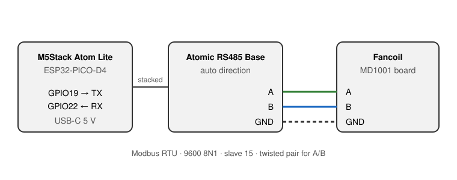

# ESPHome MD1001 Fancoil (RS485 / Modbus)

ESPHome configuration for fancoils with an **MD1001** controller board, such as
the Climasol LTV-080/CW. It reads and controls the unit over RS485 / Modbus RTU
and exposes it to Home Assistant, including every panel parameter P01–P20.

> ⚠️ The MD1001 answers with address byte `0x00` instead of its own address.
> ESPHome's `modbus_controller` rejects those replies, so this configuration
> builds and parses the Modbus frames by hand on the UART. See
> [the register map](../documents/MD1001-modbus-registers.md) for the details.

## Features

- Power on/off, mode and fan speed
- Heating, cooling and auto-mode setpoints
- All panel parameters P01–P20 as Home Assistant config entities
- Connection status that drops when the board stops answering
- New setpoints take effect immediately (the board's control loop is reloaded
  after each setpoint write)
- One small ESP per fancoil, no gateway and no cloud

## Hardware

| Part | Notes |
|---|---|
| M5Stack Atom Lite (ESP32-PICO-D4) | AtomS3 Lite works too, see the pins below |
| M5Stack Atomic RS485 Base | RS485 transceiver with automatic direction control |
| Twisted pair cable | to the A / B / GND terminals of the fancoil |

| Signal | Atom Lite | AtomS3 Lite |
|---|---|---|
| UART TX | GPIO19 | GPIO6 |
| UART RX | GPIO22 | GPIO5 |

Serial settings: **9600 baud, 8N1**, slave address **15**.

> 💡 If you get no reply at all, swap TX and RX first, then A and B. With
> TX/RX swapped the board stays completely silent – no exception, no garbage.

The Atomic RS485 Base has a DC/DC converter, so the Atom can be powered from a
12 V bus. While flashing over USB, leave that unconnected.

## Installation

1. Copy [`md1001-fancoil.yaml`](md1001-fancoil.yaml) into your ESPHome config
   folder. Use one copy per fancoil, e.g. `fancoil-living-room.yaml`.
2. Make sure `secrets.yaml` contains `wifi_ssid`, `wifi_password` and
   `api_encryption_key`.
3. Edit the `substitutions` – at least `device_name` and `friendly_name`.
4. First flash over USB: in the ESPHome dashboard choose
   **Install → Manual download → Factory format**, then flash the `.bin` with
   [web.esphome.io](https://web.esphome.io).
5. Add the device in Home Assistant (**Settings → Devices & services**).
   Later updates go over the air.

## Configuration (`substitutions`)

| Substitution | Default | Meaning |
|---|---|---|
| `device_name` | `fancoil-living-room` | Hostname, unique per fancoil |
| `friendly_name` | `Fancoil Living Room` | Prefix of every entity name in Home Assistant |
| `board_type` | `m5stack-atom` | ESPHome board |
| `uart_tx_pin` | `GPIO19` | TX towards the RS485 base |
| `uart_rx_pin` | `GPIO22` | RX from the RS485 base |
| `uart_baud` | `9600` | Baud rate of the board |
| `fancoil_address` | `15` | Modbus slave address, panel parameter P14 |
| `block_start` | `28301` | First register of the readable block |
| `block_count` | `27` | Number of registers read every poll |
| `log_level` | `INFO` | ESPHome log level |

## How it works

- Every 3 seconds the whole block 28301–28327 is read with function code 03.
- Every change is written with function code 16 (count 1); the board does not
  support function code 06.
- After each write the block is read back right away, so Home Assistant shows
  the real state within half a second.
- After a setpoint write the current mode is written again. Without that the
  board stores the new setpoint but keeps regulating on the old one until the
  next event.
- Replies are matched on function code and byte count; the address byte is
  ignored because the board always sends `0x00`.

### Mode

| Value | Mode | Active setpoint |
|---|---|---|
| 0 | Auto | auto cooling / auto heating (P05 / P06) |
| 1 | Cool | cooling (P03) |
| 2 | Dry | cooling (P03) |
| 3 | Fan only | none |
| 4 | Heat | heating (P04) |

### Fan speed

`2` low, `3` medium, `4` high, `6` auto. There is no `5`.

## Entities

### Control

| Entity | Type |
|---|---|
| Fancoil | switch |
| Mode | select |
| Fan speed | select |
| Heating setpoint | number |
| Cooling setpoint | number |
| Auto mode heating setpoint | number |
| Auto mode cooling setpoint | number |

### Status

| Entity | Type |
|---|---|
| Connected | binary sensor |
| Mode (number) | sensor (diagnostic) |

### Settings / Advanced

Shown under *Configuration* on the device page in Home Assistant.

| Entity | Parameter |
|---|---|
| P01 Maximum setpoint | max. setpoint, clamps all setpoints |
| P02 Minimum setpoint | min. setpoint, clamps all setpoints |
| P07 Fan stop below coil temperature | heating, fan stops below this coil temperature |
| P08 Fan stop on warm cooling coil | 0/1 |
| P09 Ultra-low fan speed | 0/1 |
| P10 Water valve or relay present | 0/1 – whether the board drives a valve / 24 V relay |
| P11 Floor heating | 0/1 |
| P15 Key lock | 0/1 |
| P16 Remote works while locked | 0/1 |
| P17 Password required to lock | 0/1 |
| P18 Password 1 | 1–50 |
| P19 Password 2 | 1–50 |
| P20 Fan pulses in auto mode | 0/1 |

### Diagnostic

| Entity | Why read-only |
|---|---|
| P12 Display in Fahrenheit | would change the unit of every temperature register |
| P13 Master controller | sets the role of the board in a group of units |
| P14 Slave address | changing it cuts the ESP off from the board |
| Restart | restarts the ESP |

## Important notes

- ⚠️ **The room temperature is not available over Modbus.** The panel shows it,
  but no register holds it. For automation, add a separate temperature sensor
  in the room.
- ⚠️ **Writing parameters P01–P20 is untested.** Power, mode, fan speed and the
  setpoints are verified on the display; the parameters are only verified by
  reading. Check the panel the first time you change one.
- With **P10 = 0** the board has no valve and regulates with the fan only. The
  unit keeps heating as long as hot water flows, so switching it **off** is the
  reliable way to stop it.
- One RS485 base per fancoil. If several units share one bus, give each a
  different slave address (P14) and set `fancoil_address` accordingly.

## Modbus timing

| | |
|---|---|
| Poll interval | 3 s |
| Board response time | ~28 ms |
| Frame end detection | 15 ms silence on the UART |
| Delay after a write | 400 ms before the next frame |

## Credits

Register map reverse-engineered by scanning the full Modbus address range and
matching every register to the control panel. See
[`documents/MD1001-modbus-registers.md`](../documents/MD1001-modbus-registers.md).

## Disclaimer

This project is not affiliated with Climasol or the maker of the MD1001
controller. Use at your own risk; wrong wiring or settings can damage the unit.
